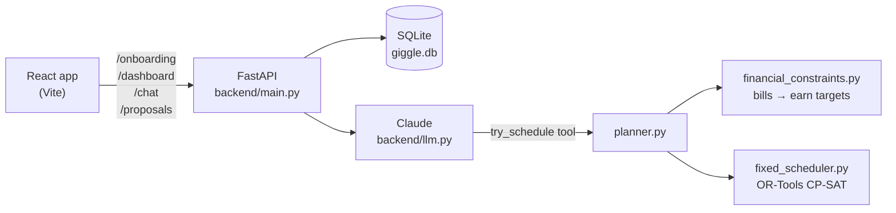

<div align="center">

# Giggle

**Gig work, planned around your life and your bills.**

[](frontend/package.json)
[](backend/requirements.txt)
[](src/backend/fixed_scheduler.py)
[](backend/llm.py)

[Overview](#overview) • [How it works](#how-it-works) • [Getting started](#getting-started) • [API](#api) • [Project structure](#project-structure)

</div>

A student who also delivers for Deliveroo has two problems: their timetable keeps changing, and so does their bank balance. Giggle reads their calendar and bank statement, works out how much they need to earn each week to cover their bills, and plans gig shifts around their lectures. They can then change the plan by chatting, for example "Am I free to take Friday off?" or "Can I earn £50 more this week?".

Built for Great Uni Hack 2026.

## Overview

- **Onboarding:** upload a `.ics` calendar and a `.csv` bank statement, pick your job and hourly pay, and describe your preferences in your own words.
- **Weekly plan:** a week grid of suggested shifts that never overlap your calendar, with a weekly earnings target taken from your real bills and spending.
- **Cash flow:** your projected balance over the next month, with and without the plan, plus **Next big payments**, which shows whether each large bill is covered.
- **Chat:** ask questions or request changes in plain English. Every suggestion is checked against the constraint solver and shown as a preview you can **Accept** or **Undo**.

> [!NOTE]
> The LLM never places shifts itself. It translates what you say into constraints, and a CP-SAT solver builds the schedule. So the answers about money and hours always come from the solver's actual result, not from the model's guess.

## How it works



1. **Parse.** The `.ics` file becomes calendar events. The `.csv` becomes transactions, from any common UK bank export or the gig-statement format with `bill_id` columns in [demo/transactions.csv](demo/transactions.csv).
2. **Money targets.** Recurring bills and average spending give three soft weekly targets:
   1. Bills and essentials, at weight 1000.
   2. Clearing the overdraft as well, at weight 100.
   3. Usual extras as well, at weight 10.

   The targets are spread across the coming month, because the solver plans one repeating week.
3. **Preferences.** Claude turns text like "Keep Sundays free, max 20 hours a week" into constraints that follow [schema.json](src/backend/schema.json). There are four kinds: `avoid`, `hours`, `shift` and `earn`. A constraint can be hard (must hold) or soft (has a weight).
4. **Solve.** CP-SAT fills 30-minute slots between 08:00 and 22:00. It minimises the penalties for broken soft constraints plus the hours worked. The solver is deterministic, so a small change doesn't reshuffle the whole week.
5. **Explain.** Claude reads what the solver produced and replies in a sentence or two, for example "you'd be £253 short of this week's bills".

## Getting started

### Prerequisites

- Python 3.12 or newer (the Anthropic SDK needs 3.10+)
- Node.js 20 or newer
- An [Anthropic API key](https://console.anthropic.com/)

### Run the backend

```bash
cd backend
python3.12 -m venv .venv
.venv/bin/pip install -r requirements.txt
echo "ANTHROPIC_API_KEY=sk-ant-..." > .env   # gitignored
.venv/bin/uvicorn main:app --reload --port 8000 --env-file .env
```

API docs are then at http://localhost:8000/docs.

> [!TIP]
> Without an API key the app still works. Onboarding builds a plan from the money targets alone, but chat returns an error.

### Run the frontend

```bash
cd frontend
cp .env.example .env.local   # VITE_API_URL=http://localhost:8000
npm install
npm run dev
```

Open http://localhost:5173 and onboard with the demo files:

| Step | File |
|---|---|
| Calendar | [demo/test_lectures.ics](demo/test_lectures.ics): a week of lectures, 9–13 Nov 2026 |
| Bank | [demo/transactions.csv](demo/transactions.csv): three months of a gig worker's statement, with 8 monthly bills |

> [!IMPORTANT]
> The plan always starts on the Monday on or after the day you onboard. The demo calendar is for the week of 9 Nov 2026, so onboarding much later than that gives an empty week grid.

### Tests

```bash
cd backend && .venv/bin/pytest -q          # API, parsing, chat flow (Claude stubbed, no network)
cd frontend && node src/lib/cashflow.test.ts
```

### Use the solver on its own

```bash
cd src/backend
python financial_constraints.py transactions.csv 2026-11-09 2 > financial.json
python fixed_scheduler.py test_lectures.ics out.ics constraints.json financial.json
```

## API

All bodies are JSON. In this demo `user_id` is a UUID that the browser generates, and it is the only identifier.

| Method | Path | Does |
|---|---|---|
| `POST` | `/onboarding` | Validates and parses the raw `.ics` and `.csv` text and replaces that user's rows. Then it builds the first plan. Returns `422` for bad input and `413` for a body over 5 MB. |
| `GET` | `/dashboard?user_id=` | Returns the profile, events, transactions, `cashflow` (balance and bills), `schedule`, `constraints` and `messages`. An unknown user gets an empty payload, not a 404. |
| `POST` | `/chat` | `{user_id, message}`. Claude answers. If its suggested plan differs from the current one, the reply carries a pending `change` with the shifts to `add` and `remove`. |
| `POST` | `/proposals/{id}` | `{user_id, accept}`. Applies or discards a pending change. |

The full contract is in [backend/SPEC.md](backend/SPEC.md).

## Project structure

```
backend/            FastAPI app
  main.py           routes and SQLite storage
  parse.py          .ics and .csv parsing
  planner.py        bank summary → earn targets → solver → week plan
  llm.py            Claude tool loop (try_schedule)
  system_prompt.md  how Claude turns requests into constraints
src/backend/        constraint solver (works on its own too)
  fixed_scheduler.py      CP-SAT model
  financial_constraints.py bills and spending → earn targets
  schema.json             constraint format
frontend/           React 19 + Vite + Tailwind
  src/Onboarding.tsx      4-step onboarding
  src/Planner.tsx         plan, cash flow and chat
  src/lib/api.ts          API client
demo/               sample calendar and bank statement
```

## Known limitations

- **One week, repeated.** The cash flow assumes this week's plan repeats each week.
- **Recurring events.** Calendar recurrence rules (RRULE) aren't expanded, so weekly events only appear in the week they're dated.
- **Time zones.** Everything is treated as UTC wall-clock time.
- **Pay rate.** Pay is a flat hourly rate, with no peak-hour boosts.
- **Equal options.** When two plans score the same, the solver may pick one that moves more shifts than needed.
- **No authentication.** Anyone with a `user_id` can read and change that user's data, which is fine for a hackathon demo.
